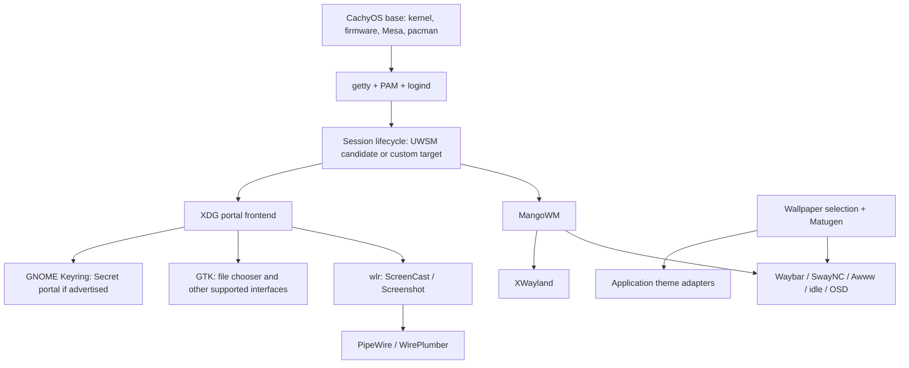

# Infrastructure and architecture

## 1. Boundaries and ownership

CachyOS owns root configuration, hardware support and performance policy. Dotfiles own user configuration and session services. Installed system packages are not automatically enabled. A package can be present without any process running. No global environment override should force all apps into Wayland when XWayland fallback is required.

## 2. Native platform baseline

| Area | Preserve / inspect | Policy |
|---|---|---|
| CPU | Zen 3 Ryzen 5 5600; x86-64-v3 supported | Let installer detect repo tier; no v4/Zen4 repo edits |
| Kernel | Current supported CachyOS kernel, optional LTS fallback | Inspect boot entries and firmware compatibility before adding fallback |
| GPU | AMDGPU, linux-firmware-amdgpu, amd-ucode, Mesa RADV | `chwd` detected profile; no AMDVLK/proprietary stack by default |
| 32-bit | lib32-mesa, lib32-vulkan-radeon, Vulkan loaders | Needed by some games/Steam; inspect meta-package |
| Updates | pacman, configured keyrings and mirrors | Full system transactions; no isolated -Sy or forced dependency bypass |
| Memory | CachyOS ZRAM and related settings | Inspect, do not override swappiness/zswap blindly |
| Scheduling | ananicy-cpp and rules if active; power profile as installed | No GameMode conflict; optional game-performance after review |
| Recovery | existing bootloader/filesystem | Btrfs/Snapper only when appropriate; test actual recovery; backups external |

Read-only inspection: `cat /etc/os-release`, `pacman-conf --repo-list`, `pacman -Q`, `chwd -l`, `lspci -k`, `vulkaninfo --summary`, `vainfo`, `zramctl`, `swapon --show`, `systemctl is-active ananicy-cpp`. `packages/native-audit.txt` lists candidates to inspect, not instructions to install everything. A missing optional native package is not necessarily an error.

## 3. Login and graphical lifecycle

Preferred flow: boot -> getty on tty1 -> password/PAM -> authenticated login shell -> explicit MangoWM launch -> graphical services -> session exit -> logout or TTY. Start manually during validation; automatic launch after successful login is a later feature. Never autologin. Leave tty2 usable for authenticated recovery; avoid leaving an unlocked shell behind a locked session. TTY switching and physical access must be tested, not assumed secured by a Wayland locker.

**Candidate A: UWSM.** Inspect installed `uwsm` man page, Mango desktop entry (`/usr/share/wayland-sessions/`), package version and environment behavior. Test `uwsm start` with the actual desktop entry ID. If Mango exports `WAYLAND_DISPLAY` to systemd itself, do not add redundant finalization; otherwise use documented `uwsm finalize` once after the socket exists. `XDG_CURRENT_DESKTOP` should be the actual Mango identifier, not forced to `wlroots`. UWSM may start XDG autostart entries; avoid starting the same agent via unit and autostart. Verify proper shutdown and repeat login.

**Candidate B: custom session target.** If A fails, maintain one wrapper and a dedicated target with `PartOf=graphical-session.target` and explicit stop on compositor exit. Start target only after the environment is available. Review target relationships against systemd semantics; no cyclic Wants/After ordering. The example unit in `systemd/user/` is not enabled. Do not mix A and B.

Service model: one owner for startup, stop and restart; foreground commands under `Type=simple`/`exec`; bounded `Restart=on-failure` where appropriate; no automatic restart of privacy-sensitive watchers or lock screen without design review. Never enable lingering just to keep desktop components active after logout.

### Runtime service matrix

| Component | Scope | Lifecycle / ownership |
|---|---|---|
| getty, logind, D-Bus, polkit, NetworkManager | System | Existing distro-managed services |
| BlueZ | System | Opt-in when Bluetooth is needed |
| UDisks2 | System | D-Bus activation; no custom daemon |
| PipeWire / pipewire-pulse / WirePlumber | User | Packaged socket/user units; preserve defaults |
| MangoWM | Session | Exactly one compositor, via selected session manager |
| Waybar / SwayNC / Awww / Swayidle / SwayOSD server | Session | One startup owner; stop on logout |
| mate-polkit | Session | One agent; discover executable with `pacman -Ql mate-polkit` |
| GNOME Keyring | User/PAM | One Secret Service owner; do not kill blindly on graphical logout |
| portal frontend and backends | User/D-Bus | Packaged activation; no redundant manual processes |
| Cliphist watchers / wl-clip-persist | Session, opt-in | Privacy gate; disable watcher on logout; private history directory |
| Udiskie | Session | One automounter; no overlapping Thunar volume management |
| MPD + mpd-mpris | User, optional | User account; bridge follows daemon; local binding |
| Rofi, Swaylock, Matugen, Grim, Slurp, Satty | On demand | Exit after use; locker owns lock until authentication |
| Thunar, Firefox, Zed, Steam, Yapfast, recorder | On demand | No prelaunch; user controls lifecycle |

## 4. Portal and environment contract

Install xdg-desktop-portal, xdg-desktop-portal-wlr and xdg-desktop-portal-gtk plus PipeWire, a picker (Slurp/Rofi) and XWayland. WLR provides ScreenCast and Screenshot; GTK provides supported dialogs and fallback interfaces. Inspect the installed `/usr/share/xdg-desktop-portal/mango-portals.conf` and actual desktop identifier before deploying any user override. `config/xdg-desktop-portal/mango-portals.conf.example` is a candidate based on current Mango docs, not a universal configuration. Keyring Secret support must be verified separately from the Secret Service D-Bus API. Do not route to a backend that does not advertise an interface. `Inhibit=none` in the upstream example does not establish app inhibit support; explicitly test controller and video idle inhibition.

Do not override Mango's own environment export with legacy `XDG_CURRENT_DESKTOP=wlroots` recipes. Inspect `systemctl --user show-environment`, portal journal and `busctl --user list` after login. Do not dump full environment or D-Bus secrets into evidence. Output selection is required; never bypass chooser globally. Window-only capture and RemoteDesktop/input sharing may be unsupported by the WLR backend. Test full monitor capture first; document limitations rather than promise feature parity.

## 5. Security and identity

- Keyring: inspect `/etc/pam.d/login` and included PAM stacks. GNOME Keyring can unlock with the authenticated password if hooks receive it; do not append blindly. Backup, keep recovery TTY and validate password login plus credential retrieval without exposing contents. Keyring passwords may differ from login passwords and require manual remediation. Do not use blank vault passwords.
- Polkit: use mate-polkit package agent (not entire MATE desktop); only one agent. No permissive polkit rules or passwordless sudo for power menu; use normal logind authorization.
- KeePassXC: GNOME Keyring owns Secret Service; KeePassXC integration off for that interface. Browser integration remains optional. Prefer browser integration or auto-type only where verified; Wayland auto-type limitations may apply. Never assume a clipboard timeout erases history.
- Clipboard: default watchers off. Test with synthetic secrets only. Verify MIME hints/filters on installed clients, history store, picker previews, persistence and restart. If filtering is not reliable, keep history disabled, or document explicit accepted residual risk and a pause/clear workflow. `wl-clip-persist` keeps active contents, not a security control. Avoid persistent primary-selection history by default.
- Lock: packaged Swaylock + Swayidle; lock before suspend with `-w` and daemonized locker readiness. Treat locker failure and inhibitor timeouts as failures. Never replace locker with fullscreen UI. Manual lock, suspend/resume, multiple outputs, session switching and authentication need physical testing.
- Yapfast: separate trust review for source/artifact and Discord account enforcement risks. No tokens in Git or automation. Official web client fallback.

## 6. Files, sound and peripherals

Thunar owns GUI directory MIME handling; Yazi owns terminal workflows. Udiskie owns automatic mounts, with GVfs/Thunar available for manual navigation and remote/trash support. Use udisks authorization, no custom mount sudo rules. Test unplug/eject and encrypted removable drives if applicable.

PipeWire + WirePlumber with pipewire-pulse/pipewire-alsa as needed. Keep JACK provider choice optional and avoid conflicts. Use wpctl for scripting, SwayOSD for feedback, pavucontrol for advanced routing. MPD runs as the user with local UNIX socket or loopback listener; verify audio backend, socket permissions and MPRIS bridge connectivity. No network-exposed MPD by default. Blueman manager on demand; applet optional. `bluetooth.service` only enabled after user selection.

## 7. Graphics and gaming

Use Steam as the single game platform for the personal profile. Keep XWayland for Steam and older clients. Verify the active 1920×1080 mode at 300 Hz on the single output. Evaluate VRR separately where supported. Use Valve Proton by default; SLR variant per-game after compatibility testing. Inspect the gaming meta-package before installation: it may bring Proton and other dependencies. No global Wine/Proton variables, Gamescope wrappers or scheduler changes. If used, game-performance follows current CachyOS documentation and is benchmarked per game. Recording is on demand; validate VA-API/encoder and capture permissions without running entire UI as root. Do not install alternative ICDs blindly.

## 8. Configuration and state ownership

| Path | Content |
|---|---|
| `$XDG_CONFIG_HOME` (default `~/.config`) | Reviewed static files and local overrides |
| `$XDG_DATA_HOME` (default `~/.local/share`) | User-owned assets, app data, MPD database where appropriate |
| `$XDG_STATE_HOME` (default `~/.local/state`) | Deployment records, theme revision, diagnostic summaries |
| `$XDG_CACHE_HOME` (default `~/.cache`) | Regenerable thumbnails/theme staging |
| `$XDG_RUNTIME_DIR` | Session locks, sockets; private, ephemeral |
| `/etc` | Distro/admin-owned; manual reviewed patch only |

Do not put private clipboard database, browser profile, password vault, Zed auth, Steam prefixes or generated theme state in the repository. Use absolute XDG paths, preserve file permissions, and isolate generated data from Stow symlink sources. See implementation plan for deployment/rollback contract.
